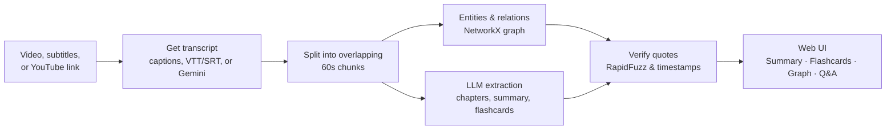

<p align="center"></p>

<p align="center">
  Turn a video into a short brief, study flashcards, and a knowledge graph,<br>
  where every claim links back to the exact moment it was said.
</p>

<p align="center">
  <em>Built for Infinity AI Forge (Hacktoberfest Hack Day Amaravati x AIBPT club, VIT-AP) &middot; Video &amp; Media Knowledge Extractor Track</em>
</p>

<p align="center">
  <a href="https://github.com/XVX-016/MLH_hackathon/actions/workflows/tests.yml"></a>
  <a href="LICENSE"></a>
</p>

---

## What you get

| Page | What it shows |
| :--- | :--- |
| **Summary** | A one-line headline, key numbers at a glance, core concepts, and a "What to remember" list. Each point links to its timestamp. |
| **Flashcards** | Question/answer study deck. Each answer carries the exact verbatim quote from the video that supports it. |
| **Graph** | Concepts and their relations in an interactive Vis.js canvas. Click any connection to inspect the underlying evidence quote. |
| **Q&A** | Grounded question answering drawer. Answers cite `[MM:SS]` moments verified against the transcript. |

Each page has its own link (for example `/#/demo_attention/graph`), so you can share a specific view.

## Try it in 2 minutes (no API key needed)

Tested on **Python 3.10 and 3.11+**.

```bash
git clone https://github.com/XVX-016/MLH_hackathon.git
cd MLH_hackathon
python -m venv .venv
# Windows:      .venv\Scripts\activate
# macOS/Linux:  source .venv/bin/activate
pip install -r requirements.txt
python run.py
```

Open <http://localhost:8000> and click **Try the demo**. The demo is precomputed: Summary, Flashcards, and Graph need no API key, and the server makes zero external network calls.

## Analyze your own video

1. Get a Gemini API key from [Google AI Studio](https://aistudio.google.com/apikey).
2. Copy `.env.example` to `.env` and set `GEMINI_API_KEY=...`. The app loads `.env` on startup.
3. Run `python run.py`, then either:
   - **Upload a file:** MP4, MKV, WebM, MP3, or WAV (up to 100 MB and 15 minutes). Submitting a **VTT or SRT** subtitle file skips audio transcription for fast, reliable ingestion.
   - **Paste a YouTube link:** seekwise reads captions via `youtube-transcript-api` and falls back to `yt-dlp` caption extraction without downloading raw video.

## How it works



Step **F** enforces evidence grounding: an edge or card is verified only when its supporting quote is matched in transcript cues around the cited timestamps.

## Evaluation

Run `python -m eval.evaluate`. Results on the bundled offline demo (`demo_attention`):

| Metric | Target | Result |
| :--- | :---: | :---: |
| Citation precision | 1.00 | **1.00** (3/3) |
| Graph grounding rate | &ge; 0.95 | **1.00** (3/3) |
| Mean quote match score | &ge; 90 | **100.0** |
| Timestamp error (MAE) | &le; 2.0 s | **0.0 s** |

On real-world YouTube video auto-captions (tested on a 6-minute sample with 23 extracted claims), resolving pipeline issues raised grounding from **9/23 (39%) to 22/23 (96%)**:

| Failure cause | Claims | Fix |
| :--- | :---: | :--- |
| Rolling auto-caption duplicates diluting quote text | 10 | Collapse rolling overlapping segments at ingestion |
| Verbatim quote cited at the wrong timestamp | 3 | Align edge temporal windows with matching transcript span |
| Quote stitched from disparate passages with "..." | 1 | Strictly rejected: passage segments exceed time threshold |

The full test suite runs with:
```bash
python -m pytest tests/
```

## Use it as a library

You can import and use the core grounding and subtitle cleaning modules independently:

```python
from videograph.grounding import is_grounded
from videograph.transcribe import deduplicate_rolling_segments, parse_vtt_or_srt

# 1. Clean rolling auto-generated captions
clean_segments = deduplicate_rolling_segments(parse_vtt_or_srt(vtt_text))

# 2. Verify whether an LLM quote actually occurred in the video window
valid = is_grounded(quote="Attention is all you need", segments=clean_segments, start=12.0, end=18.0)
```

## Open-source value

Components in this repository designed for independent reuse:
- **Rolling Caption Deduplicator** (`deduplicate_rolling_segments`): Eliminates duplicate rolling lines and strips sound effects from automated YouTube and whisper VTT/SRT captions.
- **Timestamped Grounding Validator** (`is_grounded`): Fuzzy verification engine enforcing that LLM-extracted claims exist in transcript segments within a bounded temporal window.
- **Vis.js Topology Adapter** (`to_vis_network_data`): Converts NetworkX graphs with evidence citations into interactive browser graphs with isolated node filtering.

## Configuration

Environment variables read by seekwise (configured in `.env`):

| Variable | Default | Description |
| :--- | :--- | :--- |
| `GEMINI_API_KEY` | _None_ | Google AI Studio Gemini API key for transcription and extraction. |
| `GOOGLE_API_KEY` | _None_ | Alternative alias for the Gemini API key. |
| `DEFAULT_LLM_MODEL` | `gemini-3.5-flash-lite` | Default Gemini model used for chapter, graph, and flashcard extraction. |
| `TRANSCRIBE_BACKEND` | `api` | Transcription engine mode (`api` uses Gemini multimodal audio). |
| `HOST` | `0.0.0.0` | Server bind host. |
| `PORT` | `8000` | Server port. |

## Privacy

- Media files and transcripts are uploaded only for processing and are held temporarily in local storage.
- Audio chunks and transcripts are processed using Google's Gemini API according to Google AI Studio's API data policy.
- Local temporary audio files created during upload or extraction are wiped immediately after pipeline execution.

## Built on

| Library | Used for | License |
| :--- | :--- | :--- |
| FastAPI &middot; Uvicorn | Web API and background task processing | MIT &middot; BSD-3-Clause |
| Pydantic | Schema definitions and validation | MIT |
| google-genai | Gemini API client | Apache-2.0 |
| NetworkX | Knowledge graph topology | BSD-3-Clause |
| RapidFuzz | Fuzzy string quote verification | MIT |
| sentence-transformers &middot; faiss-cpu | Semantic chunk search for Q&amp;A | Apache-2.0 &middot; MIT |
| youtube-transcript-api &middot; yt-dlp | YouTube subtitle fetching and metadata | MIT &middot; Unlicense |
| imageio-ffmpeg | Platform ffmpeg wrapper for audio normalization | BSD-2-Clause |
| vis-network | Browser knowledge graph rendering | Apache-2.0 / MIT |

## Project structure

```text
app/            FastAPI server (main.py) and static web UI (static/)
videograph/     Core package: ingest, transcribe, chunk, extract, graph, grounding, qa
data/demo/      Precomputed zero-key offline demo fixtures
eval/           Evaluation suite and grounding benchmarks
tests/          Unit and integration test suite
docs/           Team workflow and project assets
run.py          Startup script with configuration checks
```

---

Built by a three-person team (**Hardik**, **Tanmmay**, **Faariz**). Ownership rules and workflow in [docs/TEAM_WORKFLOW.md](docs/TEAM_WORKFLOW.md). Licensed under [MIT](LICENSE).
