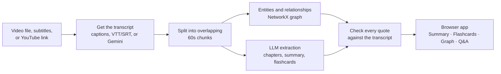

<p align="center"></p>

<p align="center">
  Turn a video into a short brief, study flashcards, and a knowledge graph,<br>
  where every claim links back to the exact moment it was said.
</p>

<p align="center">
  <a href="https://github.com/XVX-016/MLH_hackathon/actions/workflows/tests.yml"></a>
  <a href="LICENSE"></a>
</p>

**Live demo:** _coming soon_ · **Demo video:** _coming soon_

---

## What you get

| Page | What it shows |
| :--- | :--- |
| **Summary** | A one-line headline, the key numbers at a glance, core concepts, and a "What to remember" list. Each point links to its timestamp. |
| **Flashcards** | Question/answer cards. Each answer carries the exact quote from the video that supports it. |
| **Graph** | The ideas in the video and how they connect. Click any connection to see the quote behind it. |
| **Q&A** | Ask anything about the video. Answers cite `[MM:SS]` moments from the transcript. |

Each page has its own link (for example `/#/demo_attention/graph`), so you can share a specific view.

## Try it in 2 minutes (no API key needed)

Requires **Python 3.11+**.

```bash
git clone https://github.com/XVX-016/MLH_hackathon.git
cd MLH_hackathon
python -m venv .venv
# Windows:      .venv\Scripts\activate
# macOS/Linux:  source .venv/bin/activate
pip install -r requirements.txt
python run.py
```

Open <http://localhost:8000> and click **Try the demo**. The demo is precomputed: Summary, Flashcards and Graph need no API key, and the server makes no external calls (your browser still loads fonts and the graph library from public CDNs). **Q&A needs a Gemini key** (see below); without one it tells you so.

## Analyze your own video

1. Get a Gemini API key from [Google AI Studio](https://aistudio.google.com/apikey).
2. Copy `.env.example` to `.env` and set `GEMINI_API_KEY=...`. The app loads `.env` on startup. This also turns on Q&A.
3. Run `python run.py`, then either:
   - **Upload a file:** MP4, MKV, WebM, MP3 or WAV, up to 100 MB and 15 minutes long. Uploading a **VTT or SRT** subtitle file instead skips transcription, which makes it the fastest and most reliable option.
   - **Paste a YouTube link:** seekwise reads the video's captions (first with youtube-transcript-api, then with yt-dlp). It does not download the video. If the video has no captions, or is private or age-restricted, the app asks you to upload the file instead.

## How it works



The key step is **F**: a relationship or flashcard is only shown as verified when its quote is found in the transcript at the cited time (fuzzy match with RapidFuzz). Q&A answers go through the same check.

## Evaluation

Run `python -m eval.evaluate`. Results on the bundled demo:

| Metric | Target | Result |
| :--- | :---: | :---: |
| Citation precision | 1.00 | **1.00** (3/3) |
| Graph grounding rate | ≥ 0.95 | **1.00** (3/3) |
| Mean quote match score | ≥ 90 | **100** |
| Timestamp error | ≤ 2 s | **0 s** |

The demo set is small (3 edges and 3 citations), so treat these as a regression check, not a benchmark.

On a real YouTube video (a 6-minute gaming video with auto-captions, 23 extracted claims), the grounding rate went from **9/23 (39%) to 22/23 (96%)** after fixing the causes, with the 90-point match threshold unchanged:

| Failure cause | Claims | Fix |
| :--- | :---: | :--- |
| Rolling auto-caption duplicates diluting a verbatim quote | 10 | Collapse rolling captions at ingest |
| Verbatim quote cited at the wrong time | 3 | Move the claim to where the quote is actually said |
| Quote stitched from separate passages with "..." | 1 | Still rejected: the pieces are 60 s apart | The test suite runs with `python -m pytest tests/`.

## Built on

Licenses below are taken from each package's installed metadata.

| Library | Used for | License |
| :--- | :--- | :--- |
| FastAPI · Uvicorn | Web server and background jobs | MIT · BSD-3-Clause |
| Pydantic | Data contracts and validation | MIT |
| google-genai | Gemini transcription and extraction | Apache-2.0 |
| NetworkX | Knowledge graph | BSD-3-Clause |
| RapidFuzz | Quote verification | MIT |
| sentence-transformers · faiss-cpu | Semantic search for Q&A | Apache-2.0 · MIT |
| youtube-transcript-api · yt-dlp | YouTube captions and metadata | MIT · Unlicense |
| imageio-ffmpeg | Bundled ffmpeg for audio conversion | BSD-2-Clause (wrapper) |
| vis-network (browser) | Graph rendering | Apache-2.0 or MIT |

All of these allow use in an MIT project. One thing to note: imageio-ffmpeg downloads an **ffmpeg binary that is GPL/LGPL-licensed**. Using it is fine, but if you redistribute a bundle that contains it, ffmpeg's license terms apply to that binary.

## Limitations

- **Length:** videos over 15 minutes and uploads over 100 MB are rejected.
- **Language:** tested on English. YouTube subtitle download defaults to English.
- **YouTube:** only videos with captions work from a link. YouTube also often blocks requests from cloud hosts. In both cases, upload the file or its subtitles instead.
- **LLM errors:** some Gemini models are not available to new API keys, and busy models return 503 errors. The app retries, then falls back to other models. If all of them fail, the job fails with the error message.
- **Memory only:** results live in server memory, so links to your own videos stop working after a restart. The demo link always works.

## Project structure

```text
app/            FastAPI server (main.py) and the browser app (static/)
videograph/     Python package: ingest, transcribe, chunk, extract, graph, grounding, qa
data/demo/      Precomputed demo used by "Try the demo"
eval/           Grounding and citation evaluation
tests/          Unit and integration tests
docs/           Team workflow and assets
run.py          Starts the server and prints a quick-start checklist
```

The Python package is still named `videograph`, the project's original name.

---

Built by a three-person team. Ownership rules, the agent start gate, and the handoff process are in [docs/TEAM_WORKFLOW.md](docs/TEAM_WORKFLOW.md). Licensed under [MIT](LICENSE).


