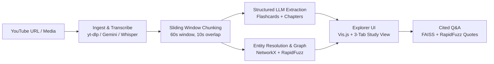

# VideoGraph 🎥🕸️

> Grounded study companion that transforms video and audio into verified knowledge graphs, flashcards, and cited Q&A.

[](https://github.com/XVX-016/MLH_hackathon/actions/workflows/ci.yml)
[](LICENSE)

🌐 **Live Demo**: *[Deploy Link Placeholder]*  
🎬 **Demo Video / Walkthrough**: *[Demo GIF / Video Placeholder]*  
👥 **Team & Workflow**: See [docs/TEAM_WORKFLOW.md](docs/TEAM_WORKFLOW.md) for 3-member ownership boundaries, start gates, and agent skills.

---

## What It Does

- 🗂️ **Interactive Study Flashcards**: Extracts high-yield question/answer cards featuring verbatim quote evidence and jump timestamps.
- 🕸️ **Interactive Knowledge Graph**: Resolves entities and maps relationships in an explorable Vis.js topology with evidence modals.
- 🎯 **Grounded Q&A with Deep Links**: Answers user questions strictly citing timestamped transcript segments `[MM:SS]`.
- 📑 **Hierarchical Chapters & Takeaways**: Generates structured summaries with verified timestamps for quick video skimming.
- ⚡ **Zero-API Offline Demo**: Ships with a precomputed, fully interactive demo so judges can evaluate all features without external API keys.

---

## Quickstart

### 1. Launch with Zero API Keys (Offline Demo)
```powershell
python -m venv .venv
.\.venv\Scripts\Activate.ps1
pip install -r requirements.txt
python run.py
```
Open **[http://localhost:8000](http://localhost:8000)** and click **"Load Demo Sample"** to instantly explore chapters, flashcards, and the knowledge graph.

### 2. Live Media & URL Ingestion
To analyze real video/audio files or YouTube URLs:
```powershell
$env:GEMINI_API_KEY="your-gemini-api-key"
python run.py
```
- **YouTube URLs**: Paste a link (< 10 min) to fetch metadata and transcribe audio in background jobs.
- **Media Upload**: Drop MP4, MKV, WebM, MP3, WAV, VTT, or SRT files directly into the UI.

---

## How It Works



---

## Evaluation Results

Automated benchmark evaluation run via `python -m eval.evaluate`:

| Metric | Target | Measured Result | Status |
| :--- | :---: | :---: | :---: |
| **Citation Precision** | 1.00 | **1.00 (3/3 verified)** | ✅ Passing |
| **Grounding Rate** | ≥ 0.95 | **1.00 (3/3 verified)** | ✅ Passing |
| **Mean Quote Match Score** | ≥ 90.0 | **100.0 / 100.0** | ✅ Passing |
| **Timestamp MAE** | ≤ 2.0s | **0.0s** | ✅ Passing |
| **Full Pytest Suite** | 62 passed | **62 passed (100%)** | ✅ Passing |

*Details and regression outputs documented in [eval/results.md](eval/results.md).*

---

## Built On

- **FastAPI & Uvicorn** (MIT): Async web server and background job polling endpoints.
- **Google GenAI SDK (`gemini-2.5-flash`)** (Apache 2.0): Multimodal audio transcription and structured JSON extraction.
- **NetworkX** (BSD-3-Clause) & **Vis.js** (MIT/Apache 2.0): Graph topology algorithms and browser visualization.
- **RapidFuzz** (MIT) & **FAISS** (MIT): Exact/fuzzy string alignment and dense vector retrieval for verified citations.
- **yt-dlp** (The Unlicense) & **ffmpeg**: Media metadata extraction and 16kHz mono audio normalization.

---

## Limitations

- Video duration is capped at 10 minutes to protect token budgets and rate limits.
- YouTube URL ingestion requires public or unlisted videos (private videos are rejected with an actionable error).
- Video scrubber jump links require media playback support in the active browser.

---

## Project Structure

```text
├── app/                  # FastAPI web server and minimalist 3-tab static frontend
├── data/demo/            # Precomputed zero-key offline demo fixtures
├── docs/                 # Team handoff protocol and delivery documentation
├── eval/                 # Citation precision & quote grounding benchmark suite
├── tests/                # 62 unit and integration tests across all modules
├── tools/                # Ownership and team boundary verification scripts
├── videograph/           # Core library: ingest, transcribe, chunk, extract, graph, qa
└── run.py                # Console-guided startup launcher
```
